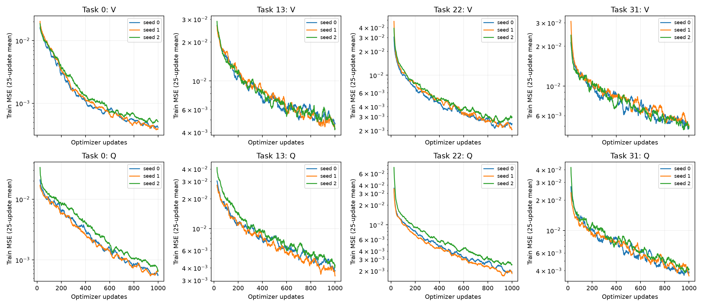
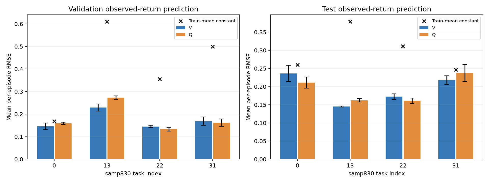
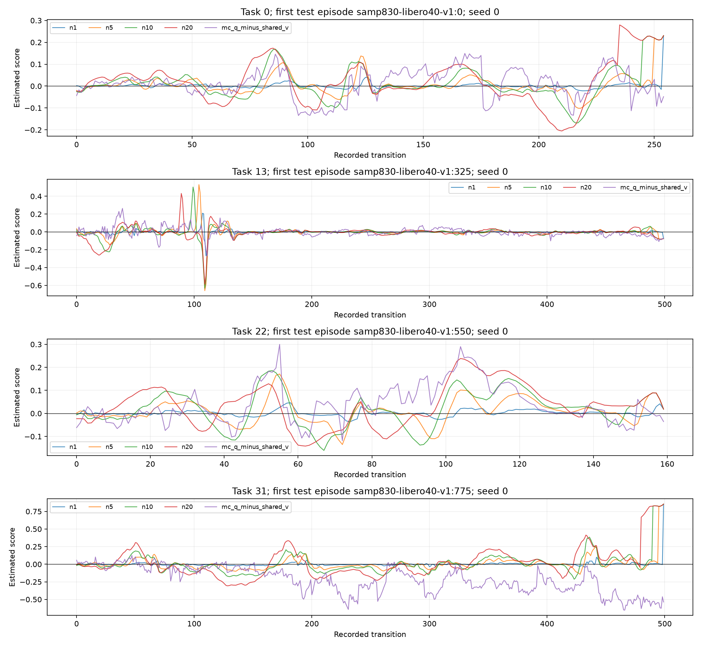

# samp830 四任务低维训练结果

原始运行：2026-11-04 21:28:51（Asia/Shanghai）；训练源码提交：6c00b283950e6957e42c259688aa10ad94260495。

**24 个正式 V／Q 模型全部完成训练，验证集与测试集的五种评分已生成，30 项仓库测试通过。**

本报告的误差衡量模型对离线轨迹实际折扣回报样本的预测，不是对真实 V／Q 或动作质量的准确率。

## 数据与配置

四个任务各 25 条轨迹；每任务训练／验证／测试为 17／3／5 条。划分种子 12，训练种子 0、1、2。γ=0.99，每模型 1000 次更新，Adam 3e-4，batch=128，两层 256 单元 MLP。训练使用 CUDA；评分沿用仓库默认 CPU 实现。

| 任务 | 任务内容 | 训练 成功/失败 | 验证 成功/失败 | 测试 成功/失败 |
|---|---|---|---|---|
| 0 | put the white mug on the left plate and put the yellow and white mug on the right plate | 5/12 | 1/2 | 3/2 |
| 13 | put the cream cheese in the bowl | 6/11 | 3/0 | 3/2 |
| 22 | pick up the cream cheese and place it in the basket | 12/5 | 3/0 | 3/2 |
| 31 | pick up the black bowl in the top drawer of the wooden cabinet and place it on the plate | 7/10 | 3/0 | 2/3 |

任务编号采用 samp830 的全局任务编号；不能直接当作原生 LIBERO 套件内编号。任务 13、22、31 的验证集均为成功轨迹，验证误差代表性有限；未据此调整模型。

## 测试集实际回报预测误差

先计算每条轨迹的 RMSE，再按轨迹等权平均，最后汇总三个训练种子的均值和样本标准差。常数基线使用训练集所有 transition 的回报均值；不读取验证或测试数据拟合。

| 任务 | V RMSE 均值 ± 标准差 | Q RMSE 均值 ± 标准差 | 训练均值常数基线 |
|---|---|---|---|
| 0 | 0.2364 ± 0.0224 | 0.2111 ± 0.0153 | 0.2598 |
| 13 | 0.1450 ± 0.0015 | 0.1621 ± 0.0045 | 0.3789 |
| 22 | 0.1725 ± 0.0081 | 0.1611 ± 0.0073 | 0.3110 |
| 31 | 0.2179 ± 0.0117 | 0.2372 ± 0.0237 | 0.2470 |

训练损失下降不能替代留出集检验；若某模型误差大于常数基线，说明本设置的回报预测泛化尚未获得支持。Q 和 V 输入不同，Q 的误差较低也不能证明 Q−V 的 Advantage 估计更准确。

## 图表

样例固定取各任务 manifest 中第一条测试轨迹及训练种子 0；未根据曲线表现挑选。各评分没有独立动作质量标签，曲线分歧只能作为后续分析线索。

## 验收

- 已核验 100 条原始 Parquet 的 SHA-256、维度、数值、时间索引、任务身份，并逐值核对转换后的状态和动作。共 32,850 个 transition。
- 已验证 24 个正式 checkpoint 的 1000 项损失有限、任务与策略匹配、可重新加载。生成并核对 133,215 行评分，检查重复、缺失、非有限值和 checkpoint 哈希。
- 每个 N-step 方法使用同一个 V checkpoint；Q 与 V 的任务、策略、gamma 和 horizon 一致。
- 原 LIBERO 环境的包版本前后核对一致；仓库训练源码保持固定提交且无改动。本次发布包含模型、评分与复现记录，原始数据、虚拟环境和缓存未上传。

## 局限与下一步

- 只有机器人末端与夹爪状态，缺少物体、目标及视觉信息；模型输入未必足以判断任务进展。
- 每任务训练轨迹只有 17 条，验证 3 条、测试 5 条；三个训练种子的波动不覆盖数据划分不确定性。
- 轨迹家族身份尚未独立核实；当前按 episode 分组，不能保证不存在共享初始状态带来的相关性。
- 成功末步奖励与失败时限终止按数据清单重建，未进行独立仿真回放核验。
- 尚无独立逐步动作质量标签，不报告动作质量 AUROC、排序准确率或某种 Advantage 更准确的结论。
- 后续优先检查误差大的轨迹、评估视觉特征的必要性，并制定独立评价标签协议；如据本次测试结果改方法，需要新的留出评价数据。

## 文件与复现

- config.json：固定训练配置；report.json：完整机器可读验收结果。
- metric_summary.csv / trajectory_metrics.csv：汇总与逐轨迹回报预测误差。
- models/：24 个正式模型（12 个 V＋12 个 Q）。本机另有 2 个短运行模型，本目录不收录。
- scores/：每任务、种子和留出集合的 TD/N-step 与 Q−V 分数。
- provenance/：原始运行脚本、结果核验脚本、依赖版本和 30 项测试日志。训练实现可从上面的固定提交取得。
- splits/：冻结的数据划分清单；raw_checksums.json：100 条原始 Parquet 的 SHA-256。原始数据和生成的 NPZ 不在本目录。

## 使用与复现

24 = 4 个任务 × 3 个训练种子 ×（1 个 V + 1 个 Q）。每个 V 被 N=1/5/10/20 共同复用，Q−V 使用匹配任务与种子的两个 checkpoint。

本目录包含模型、48 个逐步评分 CSV、指标与图表，不包含原始数据、虚拟环境、缓存和临时 staging。provenance/ 中脚本为本机原始运行记录，保留了原机器路径；在其他机器上运行时需调整路径。config.json 中 source_root 使用仓库相对路径表示，训练参数未改动。

数据源：[samp830/libero_40_suboptimal_v1](https://huggingface.co/datasets/samp830/libero_40_suboptimal_v1)，声明版本 71a88ad0eaa5f5dc5237e6ede56e7cc3d4a3e9e8。完整数据另行取得并按 raw_checksums.json 校验使用的文件。NPZ 的冻结哈希包含原运行的绝对路径元数据，跨目录重新转换时可能不同；轨迹身份和 split 应保持一致。

通用 CLI 用法见 [仓库 README](../../README.md)。复现时分别对任务 0/13/22/31 调用 convert-samp830（seed=12），然后按训练种子 0/1/2 调用 train、train-q（gamma=0.99、updates=1000），最后调用 score（ns=1/5/10/20）和 score-qv。provenance/run_training.sh 保存了本次完整命令和执行顺序；它的路径变量可按本机目录修改。使用已安装的 CUDA PyTorch 环境即可，不需要运行或下载 π0.5。

加载本次模型评分时，使用同任务、同策略及同奖励定义的 canonical 数据，并将 checkpoint 指向本目录 models/。模型可用 PyTorch weights_only=True 加载；不同设备的软件栈不保证逐位相同的重训结果。
